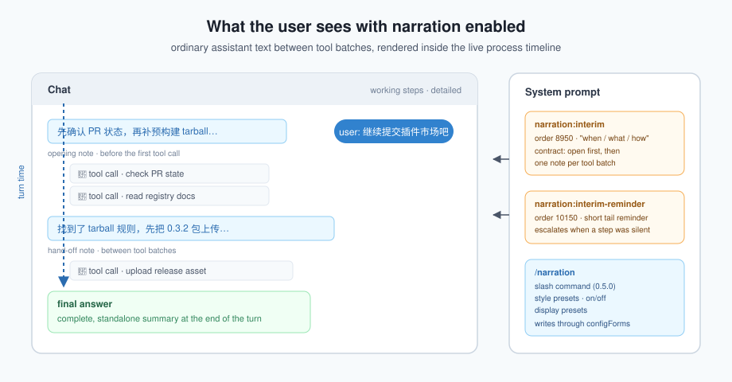

# dsh-interim-narration

[](https://github.com/ws1234567891011/dsh-interim-narration/actions/workflows/ci.yml)
[](LICENSE)
[](package.json)
[](https://www.npmjs.com/package/dsh-interim-narration)

**English** | [简体中文](README.md)

A tiny DeepSeek Harness plugin that makes the agent *think out loud*. Every turn opens with how it understands the request and what it will do first; between batches of tool calls it writes short hand-off notes as ordinary assistant text. Those notes show up in the live process timeline instead of being hidden until the final answer.



The notes are process commentary for humans — **not** raw chain-of-thought. The model's private reasoning stays a separate "thinking" block.

## How it works

This is a very small host-side [Cordis](https://github.com/cordiverse/cordis) plugin. It does exactly one thing: register prompt sections.

- Main section `narration:interim`, order `8950` (after the tool docs, before the deliverable guidance), `interpolate: false`.
- Reminder section `narration:interim-reminder`, order `10150` (near the end of the system prompt, before the persona suffix, ~126 chars), `interpolate: false`.
- No tools, no runtime context, no session writes.
- The section body is a structured writing contract with four blocks:
  - **When to speak** — open before the first tool call (1–2 sentences: how the request is understood, the plan, the first step); write between tool batches; **hard rule**: if a tool was called, at least one narration paragraph must exist in that turn; light calls may be folded into the next note; long commands and bulk edits deserve a heads-up; simple tasks may skip the middle notes but keep the opening.
  - **What to say** — the opening gives judgement and plan (what, why, which step first); then what was just finished, key findings (numbers, file names, verdicts), what is next and why; failures first state the fact and impact; when the user interjects, answer it in one sentence first.
  - **How much** — `style` selects terse / standard / verbose.
  - **How to write it** — plain paragraphs, no headings/lists/bold, in the user's language, as normal text (not `thinking`), and the narration is not the final answer.

Because the notes are regular assistant text, the chat UI decides whether they are visible. Since 0.3.0 the plugin also ships an **in-app settings page**, and since 0.4.0 it adds two safety nets:

- **Display bridge** — the settings page has a "Chat display" block bound to Chat's own `ui-chat` settings ("Transcript view" and "Collapse timing"), plus a one-click **Make the process fully visible** button (`detailed` + `next-input`). It writes only when you click it.
- **Mechanism-level enforcement** — the host half listens to `session/event` and tracks whether a tool step carried narration. When a step stayed silent, the end-of-prompt reminder gets sharper for the next step (`enforce`, `escalateAfter`). It only reads events; it never writes the session or fabricates messages.

Since 0.6.0:

- **Language follows the conversation** — `language: auto` now picks the contract language from your most recent user message (Chinese message → Chinese contract, English message → English contract); explicit `zh`/`en` still win.
- **Sentence budget follows the preset** — `maxSentences: 0` (default) means "follow the detail preset" (concise 2 / standard 3 / verbose 5 sentences); set 1–10 to override. The settings page and `/narration` show the budget for the current preset.
- **Grouped settings page** — fields are grouped into Basics / Opening and reminder / Advanced / Display in the chat; session tracking keeps at most 200 sessions (least-recently-used evicted) so long-running hosts stay bounded.

## Install

```bash
# npm, easiest
dsh plugin --profile desktop add dsh-interim-narration
```

Other options:

```bash
# local directory, linked (edits to lib/ are picked up on re-enable)
dsh plugin --profile desktop add link:C:/path/to/dsh-interim-narration

# local directory, copied into the profile
dsh plugin --profile desktop add file:C:/path/to/dsh-interim-narration
```

The command runs `pnpm add` inside the profile and appends `dsh-interim-narration` to `dsh.profile.bundles`. The package declares its own `cordis.patch.yml` via `dsh.bundle.patch`; override its `config` by targeting `id: dsh-interim-narration` in the profile patch.

After installing or updating the package, **refresh the DSH page once** (Ctrl+R / F5). If the "Configure" entry does not appear, restart the DSH app once. The client half is a plain prebuilt web bundle; no build step is required.

## Configure in-app (0.3.0+)

1. Open **Plugins** in the sidebar and find the **dsh-interim-narration** row.
2. Click **Configure**.
3. Save. The values are written to the current profile's `cordis.patch.yml` and take effect on the next turn — no restart, no refresh.

Editable fields: `enabled`, `style`, `maxSentences`, `minToolCalls`, `language`, `debug`, `reportBlockers`, `ackSteering`, `announcePlan`, `reminder`, `enforce`, `escalateAfter` (since 0.6.0 the form is grouped into Basics / Opening and reminder / Advanced / Display; `maxSentences: 0` follows the preset).
Install-time fields (`order`, `text`, `extra`, `logFile`) still need a patch edit.

The **Chat display** block at the bottom adjusts Chat's "Transcript view" and "Collapse timing" so the narration is actually visible.

> The form uses the official DSH settings pipeline (`plugins.row.config` slot + `configForms` service + host `settings` service): CAS revision checks, volatile fields only, persisted into the current profile patch.

## Making it visible

1. **Plugins** → **dsh-interim-narration** → **Configure**.
2. Under "Chat display", click **Make the process fully visible** (= `detailed` + `next-input`).

Manual equivalent: Settings → General → **Transcript view** = "Detailed" or "Expanded"; **Collapse timing** = "Next input". In "Compact"/"Standard" modes completed turns fold into a "worked for … · N tool calls" line, which is why all you see is a counter.

## Configuration

Override in the profile's `cordis.patch.yml`:

```yaml
- id: dsh-interim-narration
  config:
    enabled: true
    style: standard
    minToolCalls: 2
    language: en
```

| Field | Default | Meaning |
| --- | --- | --- |
| `enabled` | `true` | `false` keeps the plugin mounted but registers empty sections |
| `order` | `8950` | Section order (higher = later) |
| `style` | `standard` | Verbosity: `concise` / `standard` / `verbose` |
| `maxSentences` | `0` | Sentences per note, 0–10; `0` follows the `style` preset (concise 2 / standard 3 / verbose 5), 1–10 overrides |
| `minToolCalls` | `2` | Tasks with this many tool calls or fewer may skip narration; `0` = always narrate |
| `language` | `auto` | `auto` follows your latest user message (Chinese/English detected); `zh`/`en` force a language |
| `reportBlockers` | `true` | Ask the model to report blockers before continuing |
| `ackSteering` | `true` | Ask the model to acknowledge user interjections first |
| `announcePlan` | `true` | Open each turn with understanding + plan + first step |
| `reminder` | `true` | Append the short end-of-prompt reminder |
| `enforce` | `true` | Mechanism-level escalation when a step stayed silent |
| `escalateAfter` | `1` | Silent steps before escalation (1–5) |
| `text` | — | Replace the built-in section text |
| `extra` | — | Append extra rules after the built-in text |
| `debug` | `false` | Write mount logs (rotated at 64 KiB) |
| `logFile` | `$DSH_HOME/dsh-interim-narration.log` | Debug log path |

The first twelve are volatile and editable in-app; `order`/`text`/`extra`/`logFile` need a patch edit.

## Verify

Set `debug: true` and check `~/.dsh/dsh-interim-narration.log` for a line such as
`mounted order=8950 style=standard ... enforce=true escalateAfter=1 sectionChars=<n> reminderChars=<n>`,
plus `volatile-update paths=… language=…` after an in-app save and `reminder-escalated silentSteps=… lang=… sessionLang=…` when the safety net kicks in (an English turn flips the contract to English and reports `sessionLang=en`).

Or simply ask the agent: "repeat verbatim the system-prompt section that starts with `## 过程叙述`".

## Cost

Narration is extra output tokens (usually tens to ~100 per tool batch); `enabled: false` turns it off instantly.

## Cache impact (prompt cache)

- The plugin keeps no cache of its own and never touches host cache files; it only changes two blocks of the system prompt.
- The main contract block (~950 characters) is static while the config is stable: the first request in a conversation pays for it, later ones hit the cache and are billed at the cached rate.
- The trailing reminder is dynamic: with `enforce` on, a silent tool step appends one line. Since 0.7.0 that line is **latched for the whole turn** — the prompt stays byte-identical while silence continues and only flips on the first trigger and on the next narrated turn, so it stops invalidating the prefix on every silent step.
- `language: auto` switches the template with the conversation language; a switch rewrites the system-prompt prefix, so the provider's prefix cache breaks at the system prompt and that request's history is re-prefilled.
- Saving any settings field also rewrites the prefix for the next request — one invalidation per save.
- To maximise cache hits: pin `language` to `zh` or `en`, disable `enforce` or raise `escalateAfter` when you do not need the safety net, and avoid editing settings mid-conversation.
- For the underlying mechanics see DSH's `llm-pi-ai` docs, "KV Cache impact": providers reuse by request prefix, and any change to earlier content ends reuse at that point.

## Uninstall

```bash
dsh plugin --profile desktop remove dsh-interim-narration
```

## Project layout

```
dsh-interim-narration/
├── lib/
│   ├── core.js        # pure logic + host mounting (Node built-ins only)
│   ├── index.js       # schemastery Config (volatile fields) + public exports
│   └── client.js      # hand-written web bundle: in-app config page + /narration
├── test/
│   ├── smoke.mjs            # host-side assertions (38 cases)
│   ├── client-smoke.mjs     # client bundle registration/rendering assertions
│   ├── pack-smoke.mjs       # npm pack manifest assertions
│   ├── mock-llm.mjs         # local OpenAI-compatible mock for E2E checks
│   └── overlay-mock.example.yml
├── docs/images/narration-flow.svg
├── cordis.patch.yml
├── package.json
├── CHANGELOG.md
├── CONTRIBUTING.md
├── SECURITY.md
└── LICENSE
```

## Compatibility

- DSH `0.2.x` (verified on `0.2.1-rc.2`). The manifest says so in machine-readable form: `dsh.engines.dsh: ">=0.2.1-rc.0 <0.3.0"`, so the plugin manager checks the host version before installing or enabling (an unsatisfied range surfaces an exemption prompt). The host half only needs the `systemPrompt` service; the client half uses `slots` / `locale` / `configForms` and optionally `commandUi`.
- Without the settings services the plugin still works; you just lose the form.
- Since 0.6.0 `language: auto` needs the user-message text from `session/event`; without that event it falls back to Chinese (the 0.5 behaviour), and explicit `zh`/`en` are unaffected.
- No runtime dependencies. `@deepseek-ai/schemastery` is an optional host-provided peer used only to declare `Config`.

## Contributing

Issues and PRs welcome — see [CONTRIBUTING.md](CONTRIBUTING.md). CI runs the three test scripts on Node 20/22/24.

## License

[MIT](LICENSE) © 2026 ws1234567891011
