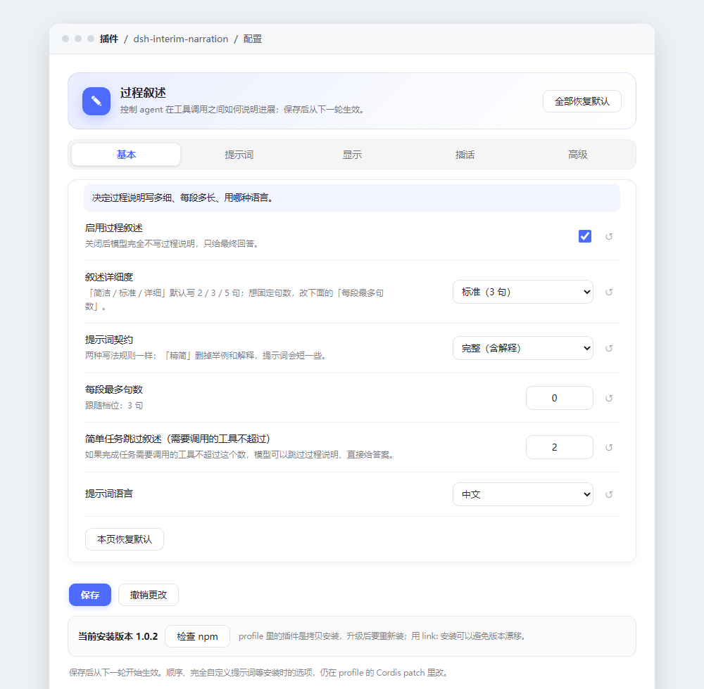
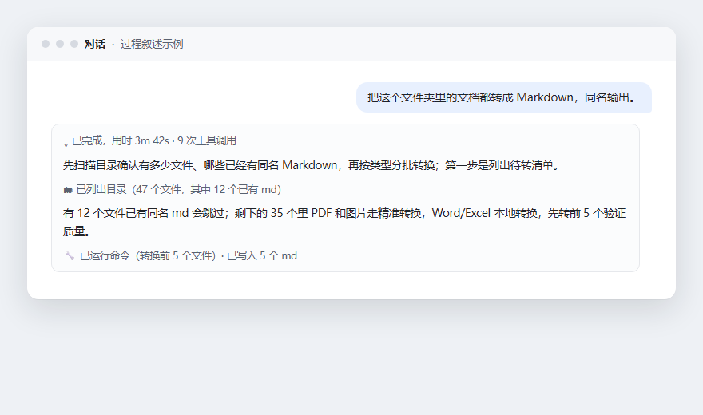
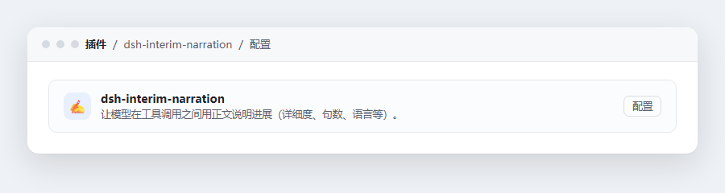

# dsh-interim-narration

[](https://github.com/ws1234567891011/dsh-interim-narration/actions/workflows/ci.yml)
[](LICENSE)
[](package.json)
[](https://www.npmjs.com/package/dsh-interim-narration)

**English** | [简体中文](README.md)

This plugin makes the agent in DeepSeek Harness talk while it works. Every turn it opens with a sentence or two about how it reads your message and what it is about to do, then drops a short note after each batch of tool calls, instead of quietly chaining tools and dumping one big answer at the end.

It looks roughly like this (together with the chat's "work steps" setting):

```
I'll split these files by type first: PDFs get converted, Word files convert directly, images last.
  [read 12 files] [ran a command]
Three of them are scans — the text will need manual checking, so I'm setting those aside. The other nine convert cleanly.
  [edited a file]
```

Those paragraphs are process commentary for you, not the model's raw chain-of-thought; the private reasoning stays in its own "thinking" block.

## Screenshots



The page has four blocks — Basics, Opening and reminder, Advanced, Display in the chat — plus a live prompt preview showing the exact text the host injects, its character count and an estimated token count.

What the narration looks like in the chat (illustrative, colours follow your theme):



The row in the plugin list:



## Install

```bash
# npm
dsh plugin --profile desktop add dsh-interim-narration
```

Or install a local checkout (`link:` follows your source edits, `file:` copies it):

```bash
dsh plugin --profile desktop add link:C:/path/to/dsh-interim-narration
```

Refresh the page afterwards (Ctrl+R). There are three entries for the same page: **Settings → Narration** (recommended), the “Interim narration” row in the sidebar, or the Configure button on the plugin's row in the sidebar Plugins page; if it doesn't show up, restart DSH once.

## Tuning

Open **Settings → Narration** (or Plugins → `dsh-interim-narration` → Configure — the same page). Saving takes effect on the next turn, no restart needed.

The fields you'll actually touch:

| Field | Default | What it does |
| --- | --- | --- |
| `enabled` | on | Turning it off empties the prompt section; the plugin stays mounted |
| `style` | standard | How much it talks: concise 2 / standard 3 / verbose 5 sentences |
| `contract` | full | Switch to compact to save about 59% of the contract characters; same rules, fewer explanations |
| `maxSentences` | 0 | 0 follows the `style` budget; 1–10 pins it |
| `language` | auto | Follows the language of your last message; can be pinned to Chinese or English |
| `announcePlan` | on | Opens each turn with understanding and plan |
| `enforce` | on | If a tool step had no narration, the next reminder gets sharper |
| `escalateAfter` | 1 | How many silent steps before it gets sharper; 1 is the most eager |

`order`, `text`, `extra` and `logFile` are install-time options — edit `cordis.patch.yml` in your profile for those.

Just want to see it? The settings page has two buttons at the bottom:

- **Recommended: fold after the answer** sets standard + after-the-answer + final-answer-only, so the process folds itself when the reply ends and only the final answer stays in the transcript;
- **Keep the process visible** sets detailed + keep-open-until-next-message + all replies, for when you want to watch it work.

The "Replies kept after collapse" setting is what DSH 0.2.2 added: *All replies* keeps the narration paragraphs between tool calls in the transcript, while *Final answer only* leaves just the answer once a turn folds. Both buttons write only when you click them, and never touch your settings on their own.

## Why can't I see it sometimes

1. **The chat folded it.** The default compact/standard modes collapse finished turns into "done, took 3m · 9 tool calls". Click that row, or use the button above.
2. **It actually didn't narrate.** Models forget when they get busy. The plugin puts a short reminder at the end of the system prompt, and sharpens it after silent steps (`enforce`, `escalateAfter`).
3. **You want to spend fewer tokens.** Switch `contract` to compact or lower `style`.

## What it actually changes

One thing: it registers two pieces of text in the system prompt — a full description of the working convention (when to speak, what to say, how) and a short reminder at the end.

No tools, no session writes, no faked messages, no network calls, no runtime dependencies. Everything comes from the prompt, so the ceiling is "the model is more willing to narrate" — it can't force it.

## Cache impact

The plugin doesn't cache anything and doesn't touch host caches; it edits the system prompt, which does affect server-side prefix caching:

- The main contract is static while your settings don't change: paid once, then cached.
- The end-of-prompt reminder is dynamic: a silent step adds a line. Since 0.7.0 that line stays identical for the rest of the turn, so the prefix changes once when it appears and once when it clears, not on every step.
- `language: auto` is decided once per turn from the first user message, so it doesn't flip back and forth.
- Changing settings invalidates the next turn's prefix once, which is expected.

To maximise cache hits: pin the language, turn `enforce` off when you don't need the safety net, and avoid editing settings in the middle of a conversation.

We also measured the alternative of moving the dynamic reminder to the end of the request (the host's runtime context). It does keep the system prompt byte-identical, but every silent step adds a persisted ~230-token context message that keeps being billed on later requests; with a 50k-token history and cache hits at roughly a tenth of the price, it takes about two thousand more requests to break even. So we kept the current design.

## Fold after an interjection (local switch)

DSH has a built-in behaviour: if you send a message while a turn is still running, that turn's process group stays open for the rest of the turn and cannot be folded when it finishes — `ui-chat` treats "there was an interjection" as a permanent reason to keep it open. Since 1.0.0 the plugin exposes a local switch at Settings → Interim narration → Interjections (the plugin page's config is the same page):

- the status line shows "patched / original / mixed" plus the `app.asar` path and size;
- **Apply patch** rewrites three equal-length byte ranges in the installed `resources/app.asar` and keeps a backup named `app.asar.bak-interleaved`;
- **Restore** copies the backup back.

Restart DSH fully after changing it. A DSH update overwrites `app.asar`, the status returns to "original", and one more click re-applies it. This switch touches local files only; it writes no profile config and is not part of the npm release.

## Settings page: sidebar entry and horizontal tabs (1.0.1+)

- Besides Settings → Interim narration, the page now also appears in the sidebar as an "Interim narration" row; opening it shows the full page. Hosts without a sidebar slot skip this automatically.
- The page uses horizontal tabs: Basics / Prompt / Display / Interjections / Advanced, showing one section at a time instead of a long column.
- Inactive panels stay mounted, so the prompt preview and patch status keep refreshing in the background.

Since 1.0.1 both ship with the npm package and the GitHub release; each tab also has its own “Reset this page”, with “Reset everything” at the top-left.


## Versioning and releases

Since 1.0.0 this project follows semantic versioning: within 1.x no existing option is removed and the settings page and `/narration` command keep working, while new capabilities arrive with defaults. Every release declares what changed and whether upgrading needs an action, in [CHANGELOG.md](CHANGELOG.md) and the GitHub Release; the release workflow runs `node test/release-check.mjs` before publishing and fails if that declaration is missing. The full policy is in [VERSIONING.md](VERSIONING.md).

## Compatibility

- DSH `0.2.x` (verified on 0.2.1-rc.2 and 0.2.1-rc.3). `package.json` declares a machine-readable `dsh.engines.dsh`, which the plugin manager checks before install.
- Needs the host `systemPrompt` service. The settings page needs the settings services (`configForms` + `plugins.row.config`). The `/narration` command needs `commandUi` and is skipped when absent.
- Without the `session/event` stream, silent-step escalation and automatic language follow degrade to static behaviour; everything else still works.

## Development

```bash
npm test            # host logic + client bundle + package manifest
npm run test:e2e    # one real headless DSH run against a local mock model (~6s)
```

`test/e2e.mjs` finds a local DSH install on its own and prints `SKIPPED` when there isn't one, so CI and machines without DSH can still run it. See [CONTRIBUTING.md](CONTRIBUTING.md) for details.

Releases are cut by `.github/workflows/release.yml`: pushing a tag publishes to npm and creates the GitHub Release. It still uses the `NPM_TOKEN` repository secret; moving to npm Trusted Publishing requires 2FA to be enabled on the account first, and the workflow carries a TODO for that switch.

## Uninstall

```bash
dsh plugin --profile desktop remove dsh-interim-narration
```

## License

[MIT](LICENSE) © 2026 ws1234567891011
