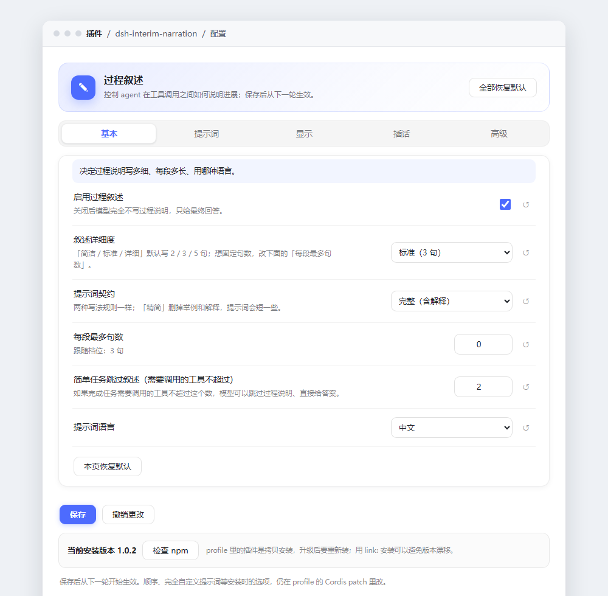
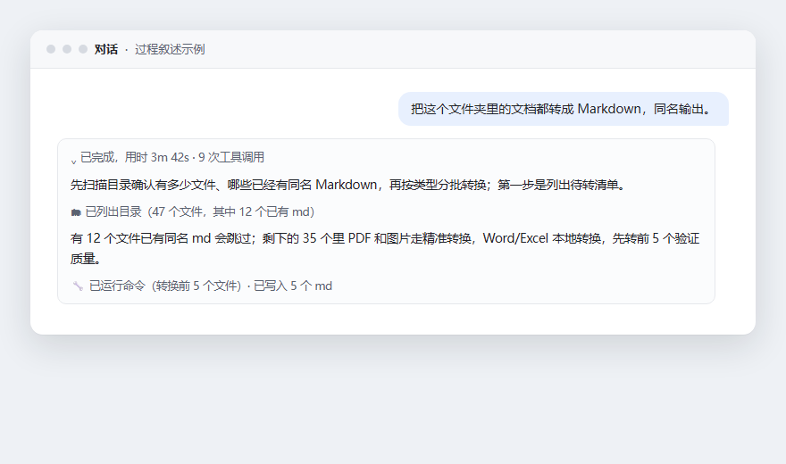
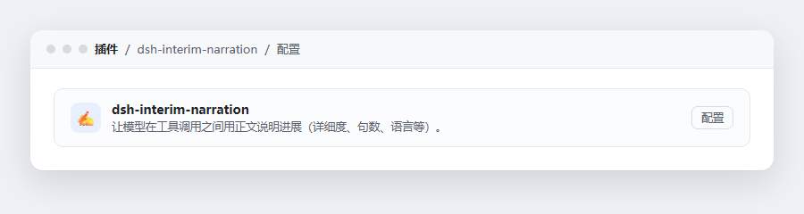

# dsh-interim-narration

[](https://github.com/ws1234567891011/dsh-interim-narration/actions/workflows/ci.yml)
[](LICENSE)
[](package.json)
[](https://www.npmjs.com/package/dsh-interim-narration)

**简体中文** | [English](README.en.md)

装了这个插件，DeepSeek Harness 里的 agent 干活时会先说话：开头用一两句交代自己怎么理解你的消息、准备怎么做，之后每干完一批活再写一两句汇报，而不是闷头调工具、最后突然甩一个大答案。

效果大概是这样（配合聊天里的「工作步骤展示」设置）：

```
我先把这批文件按类型分组：PDF 走转换，Word 直接转，图片最后处理。
  [读取了 12 个文件] [运行了命令]
有 3 个是扫描件，转出来需要人工核对，先放一边；剩下 9 个可以直接转。
  [编辑了文件]
```

这些段落是给你看的工作说明，不是模型的原始思维链——原始思考仍然是单独的「思考」块。

## 界面预览



配置页分四块：基本、开场与提醒、进阶、聊天里的显示。中间的「提示词预览」会显示当前设置下实际注入给模型的文字、字符数和大概的 token 数，改完可以先看效果再保存。

过程叙述在聊天里的样子（示意，配色跟随主题）：



「插件」页里的那一行：



## 安装

```bash
# npm
dsh plugin --profile desktop add dsh-interim-narration
```

也可以装本地目录（`link:` 跟随源码改动，`file:` 是复制一份）：

```bash
dsh plugin --profile desktop add link:C:/path/to/dsh-interim-narration
```

装完刷新一下页面（Ctrl+R）。配置入口有三个，都是同一个页面：**设置 → 过程叙述**（推荐）、侧边栏「过程叙述」，或侧边栏「插件」里这一行的「配置」；如果没出现，重启一次 DSH。

## 调整

打开 **设置 → 过程叙述**（或「插件」→ `dsh-interim-narration` →「配置」），保存后下一轮对话生效，不用重启。

常改的几项：

| 字段 | 默认 | 作用 |
| --- | --- | --- |
| `enabled` | 开 | 关掉后提示词段落变空，插件本身还挂着 |
| `style` | 标准 | 说话多少：简洁 2 句 / 标准 3 句 / 详细 5 句 |
| `contract` | 完整 | 改「精简」能省约 59% 的契约字符，规则不变、解释变少 |
| `maxSentences` | 0 | 0 表示跟着 `style` 的句数走，填 1–10 则固定 |
| `language` | 自动 | 自动跟随你最近一条消息的语言，也可以固定中/英 |
| `announcePlan` | 开 | 每轮开头先说理解和计划 |
| `enforce` | 开 | 某一步只调工具没说话，下一条提示会加压 |
| `escalateAfter` | 1 | 连续静默几步开始加压，1 最积极 |

`order`、`text`、`extra`、`logFile` 属于安装期参数，改它们要编辑 profile 里的 `cordis.patch.yml`。

只想看效果的话，配置页底部有两个按钮：

- 「**推荐：回答结束后自动收起**」→ 设成「标准 + 回答结束后 + 仅最终回答」，回答完成时过程块自动折叠，时间线里只剩最终答案；
- 「**全程展开过程**」→ 设成「详细 + 下次有新消息时 + 全部回复」，适合想盯全程的时候。

其中「收起后显示的回复」是 DSH 0.2.2 新增的开关：选「全部回复」会把工具调用之间的过程叙述保留在时间线里，选「仅最终回答」才会在折叠后只留下答案。两个按钮都只在你点击时写入，不会偷偷改你的设置。

## 为什么有时候看不到它说话

1. **聊天折叠了**：默认的「简洁/标准」会把已完成的轮次收成「已完成，用时…… · N 次工具调用」。点开那一行，或直接用上面的一键按钮。
2. **它真的没说**：模型忙起来容易忘。插件会在系统提示末尾放一条短提醒，连续静默时提醒会变硬（`enforce`、`escalateAfter`）。
3. **省 token**：把 `contract` 改精简，或把 `style` 调低。

## 它到底改了什么

只做一件事：往系统提示里注册两段文字——一段是完整的工作说明（什么时候说、说什么、怎么说），一段是结尾的短提醒。

不调工具、不写会话、不伪造消息、不联网、没有运行时依赖。所有效果都来自提示词，所以上限就是「让模型更愿意说」，做不到强制。

## 缓存影响

插件自己不缓存任何东西，也不碰宿主缓存；它改的是系统提示，因此会影响服务端的 prompt 前缀缓存：

- 主契约在设置不变时是静态的，第一次付费、之后命中缓存。
- 结尾提醒是动态的：某一步静默后会多出一句。0.7.0 起这句在整轮内保持不变，只在触发和恢复时各变一次，不会每步都让缓存失效。
- `language: auto` 只在每轮的第一条消息上判断一次，轮内不会来回翻。
- 改设置会让下一轮的前缀失效一次，这很正常。

想尽量多命中缓存：把语言固定成中文或英文，不需要兜底时关掉 `enforce`，尽量别在对话中途改配置。

顺便说一句实测结论：也试过把动态提醒挪到请求末尾（宿主运行时上下文），它确实能让系统提示完全不变，但每次静默都会多一条约 230 tokens 的上下文消息，之后每个请求都要为此付费；按「历史 5 万 token、命中价约一成」估算，要同一会话再跑两千多次才回本，所以没有采用，保持现在这套做法。

## 轮次内插话后也折叠（本机开关）

DSH 本身有个行为：一轮回答进行中你插一句话，这一轮的过程组会整轮保持展开，回答结束后也折叠不了——`ui-chat` 把「有插话」当成了常开条件。插件在 1.0.0 之后加了一个本机开关，入口在「设置 → 过程叙述 → 轮次内插话」（插件页的配置里也是同一页）：

- 状态会显示「已启用补丁 / 原版未打补丁 / 混合」，并给出当前 `app.asar` 的路径和字节数；
- 点「启用补丁」会修改安装目录里的 `resources/app.asar`（三处等长字节替换），并自动备份成 `app.asar.bak-interleaved`；
- 点「还原」从备份恢复。

改完需要完全退出 DSH 再打开才生效。DSH 升级会覆盖 `app.asar`，状态会回到「原版」，再点一次「启用补丁」即可。这个开关只动本机文件，不写 profile 配置，也不随 npm 版本发布。

## 设置页：侧边栏入口与横向分区（1.0.1+）

- 除了「设置 → 过程叙述」，页面现在也会出现在侧边栏，显示为一行「过程叙述」，点开即整页配置；宿主没有侧边栏插槽时自动跳过。
- 页面顶部改成横向标签：基本 / 提示词 / 显示 / 插话 / 高级，下方只显示当前标签的内容，不再是一长列。
- 未激活的面板仍然保持挂载，提示词预览和补丁状态会在后台继续刷新。

从 1.0.1 起，这两项随 npm 包和 GitHub Release 一起发布；每个标签页底部还有「本页恢复默认」，页面左上角是「全部恢复默认」。


## 版本与发布

从 1.0.0 起按语义化版本（SemVer）发布：1.x 内不删除已有配置项、不改变设置页与 `/narration` 命令的用法，新增能力只加默认值。每个版本都会在 [CHANGELOG.md](CHANGELOG.md) 和 GitHub Release 里写明改了什么、升级要不要动作；发布工作流会在发 npm 之前跑 `node test/release-check.mjs`，版本声明缺失就直接失败。完整规则见 [VERSIONING.md](VERSIONING.md)。

## 兼容性

- DSH `0.2.x`（在 0.2.1-rc.2、0.2.1-rc.3 上验证过）；`package.json` 里有机器可读的 `dsh.engines.dsh`，插件管理器安装前会检查。
- 需要宿主的 `systemPrompt` 服务；配置页需要设置服务（`configForms` + `plugins.row.config`）；`/narration` 快捷命令需要 `commandUi`，没有就自动跳过。
- 没有 `session/event` 事件时，静默加压和语言自动跟随会退化成静态行为，其余功能不受影响。

## 开发

```bash
npm test            # 宿主逻辑 + 客户端 bundle + 打包清单
npm run test:e2e    # 真跑一次 headless DSH + 本地 mock 模型，约 6 秒
```

`test/e2e.mjs` 会自己找本机的 DSH；找不到就打印 `SKIPPED` 退出（CI 和没装 DSH 的机器都能跑）。更多说明见 [CONTRIBUTING.md](CONTRIBUTING.md)。

发布由 `.github/workflows/release.yml` 完成（打 tag 即发布 npm + GitHub Release）。目前仍用仓库 secret `NPM_TOKEN`；迁移到 npm Trusted Publishing 需要账号先开启 2FA，workflow 里留了 TODO。

## 卸载

```bash
dsh plugin --profile desktop remove dsh-interim-narration
```

## License

[MIT](LICENSE) © 2026 ws1234567891011
